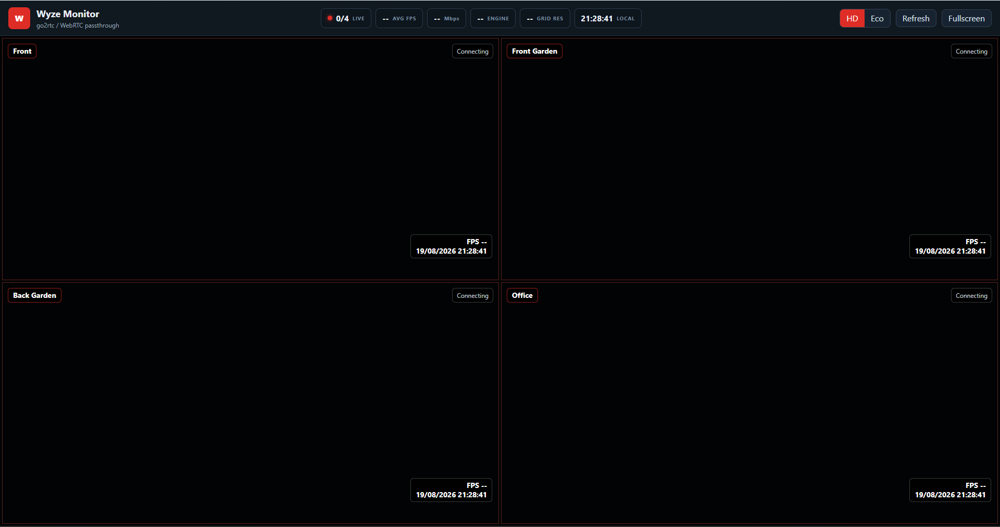

# go2rtc-wyze-monitor

A low-CPU multi-camera dashboard for **Wyze Cam v4** over local RTSPS.

Most Wyze viewers decode the camera stream, scale it down, and re-encode it as
MJPEG for the browser. That is expensive and throws away most of the picture.
This project decodes nothing: FFmpeg remuxes the camera's H.264 straight into
[go2rtc](https://github.com/AlexxIT/go2rtc), which serves it to an Electron
window over WebRTC. The GPU does the only decode, at full resolution.

```
Wyze RTSPS H.264 -> FFmpeg copy (no decode) -> go2rtc -> WebRTC -> <video>
```



*Shown with the cameras unreachable, so the tiles are empty. In use each tile
carries live video and the strip fills in with camera count, frame rate and bitrate.*

Measured on four cameras, replacing an MJPEG pipeline on the same machine:

| | MJPEG pipeline | This project |
|---|---:|---:|
| Grid resolution | 960x540, recompressed | **2560x1440**, bit-exact |
| Frame rate | 12-24 fps, uneven | **~20 fps**, steady on all four |
| CPU, whole stack | ~27% | **1.3%** |

Frame rate is capped by the camera, which encodes at 20 fps. Nothing downstream
can raise that — but the unevenness was pipeline bottleneck, and it goes away.

---

## Requirements

### 1. Firmware with RTSP support — read this first

**RTSP is not in the standard Wyze Cam v4 firmware.** Wyze ships it as a separate
RTSP-enabled build, and if your camera is on a normal release you will not see
the RTSP option in the app at all. This is the single most common reason people
cannot get started.

To check what you have: Wyze app → your camera → **Settings → Device Info →
Firmware Version**. Then look for **Settings → Advanced Settings → RTSP**. If
that RTSP entry is absent, you are not on an RTSP build.

Getting onto one:

- Wyze's RTSP page: <https://support.wyze.com/hc/en-us/articles/360026245231-Wyze-Cam-RTSP>
- Wyze's RTSP beta instructions: <https://wyze-beta.s3.us-west-2.amazonaws.com/rtsp.html>

The v4 RTSP build is flashed from a microSD card as a recovery image named
`recovery_wcv4.bin` — you copy it to the root of a FAT32 card, power the camera
with the setup button held, and wait for it to flash. **Download that file from
Wyze directly.** This repository does not redistribute firmware: it is Wyze's to
license, and flashing a binary from a stranger's repo into a camera on your home
network is a bad idea regardless.

Notes from the setup this was built against:

- The RTSP build has historically been a beta/limited release rather than a
  general rollout, and availability has come and gone. If the beta page is not
  serving a v4 image, check the Wyze forums for the current state.
- Once flashed, **do not let the camera auto-update.** A normal firmware update
  will remove RTSP and you will have to flash again.
- Enabling RTSP is per camera, and you set a username and password per camera in
  the app at that point. Those are what go into `cameras.yaml`.

### 2. Everything else

- **Windows** (the launcher and setup script are PowerShell; the app itself is
  portable, but nobody has tested it elsewhere)
- **Node.js** 18+ — <https://nodejs.org/>
- **FFmpeg** — `winget install Gyan.FFmpeg`, or set an absolute path in `cameras.yaml`
- **go2rtc** — downloaded automatically by the setup script
- Cameras on a wired or strong Wi-Fi connection, with **static IPs or DHCP
  reservations**. If a camera's address changes, its tile goes dark.

---

## Setup

```powershell
git clone https://github.com/bobster316/go2rtc-wyze-monitor.git
cd go2rtc-wyze-monitor
powershell -ExecutionPolicy Bypass -File scripts\setup.ps1
```

The first run creates `cameras.yaml` and stops so you can fill it in:

```yaml
ffmpeg: ffmpeg
defaultQuality: main

cameras:
  - id: front
    name: Front
    ip: 192.168.1.10
    user: Front
    password: your-rtsp-password
```

Add as many cameras as you like — the grid adapts. Then run setup again, and:

```powershell
npm start
```

`cameras.yaml` is gitignored. It is the only place your passwords live;
`go2rtc/go2rtc.yaml` is generated from it and is gitignored too.

---

## Using it

| Control | What it does |
|---|---|
| **HD / Eco** | Grid tiles pull the full-resolution stream, or the low-resolution substream |
| **Refresh** | Rebuilds every tile |
| **Fullscreen** | Fullscreen the whole grid |
| Double-click a tile | Enlarge it, always at full resolution |
| **Reconnect** (per tile) | Restarts just that camera |

The status strip shows live camera count with a traffic-light dot, average FPS,
total bitrate from WebRTC stats, the transport in use, grid resolution, and a clock.

**HD vs Eco.** In HD each tile pulls the full 2560x1440 stream and the GPU scales
it to tile size — best quality, and cheap if your GPU does H.264 decode. Eco pulls
the 640x360 substream instead, for weak hardware or remote links. Enlarging a
camera always uses full resolution either way.

---

## How it works

go2rtc holds two stream definitions per camera, `<id>_main` and `<id>_sub`, and
starts an FFmpeg process for one only while something is watching it. With a
four-camera grid open you should see four `ffmpeg.exe`, not eight.

The app supervises go2rtc as a child process: it starts on launch, restarts with
backoff if it dies, and is killed along with its FFmpeg children on exit.

| Port | Used by |
|---|---|
| 8765 | The app's local HTTP server (UI, `/api/config`, `/api/health`) |
| 1984 | go2rtc API, WebSocket signalling, web UI |
| 8554 | go2rtc internal RTSP (FFmpeg publishes here) |
| 8555 | go2rtc WebRTC |

All bind to `127.0.0.1` except WebRTC. Nothing is exposed to the internet, and
that is deliberate — see [docs/ARCHITECTURE.md](docs/ARCHITECTURE.md).

---

## If it does not work

[docs/TROUBLESHOOTING.md](docs/TROUBLESHOOTING.md) covers the failure modes that
cost real time, including:

- **go2rtc alone cannot talk to these cameras.** Plain `rtsps://` sources fail
  with an i/o timeout. This project uses `exec:` sources for a reason — do not
  "simplify" them.
- Antivirus TLS interception on the RTSP port
- The YAML backslash trap on Windows paths
- Tiles black in HD but fine in Eco

---

## Credits

- [go2rtc](https://github.com/AlexxIT/go2rtc) by AlexxIT — does the actual work.
  `src/vendor/video-rtc.js` is its player component, MIT licensed.
- [MediaMTX](https://github.com/bluenviron/mediamtx) and
  [docker-wyze-bridge](https://github.com/mrlt8/docker-wyze-bridge) are worth
  looking at if this does not suit you.

MIT licensed. Not affiliated with or endorsed by Wyze Labs.
