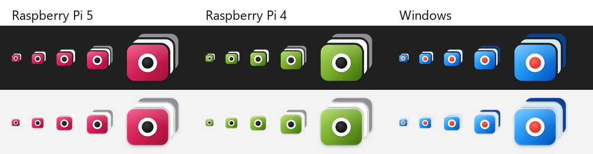

# App icons

Wyze Monitor uses one mark on every platform: a front screen carrying a live
dot, with more screens stacked behind it ("your live camera feeds"). It has
no text and does not show a fixed number of cameras, so it stays correct as
cameras are added, and it stays legible at 16 px.



## One colour per device

When the app runs on several machines, the colour tells you which one you are
looking at:

| Device | Colour | Variant |
|---|---|---|
| Windows desktop app | Windows 11 blue | `windows` |
| Raspberry Pi 5 (and default Pi) | Raspberry red | `pi` |
| Raspberry Pi 4 | Leaf green, from the Raspberry Pi logo | `pi4` |

On a Pi, the colour applies to the dashboard's browser-tab icon and to the
desktop and application-menu launcher:

- **Browser tab:** `ICON_VARIANT` in `raspberry-pi/.env` (`pi` or `pi4`)
  picks the icon. The Pi 4 Compose profile defaults it to `pi4`, so a Pi 4 is
  green without any setting. See [configuration](CONFIGURATION.md#4-pi-server-configuration).
- **Launcher:** `install.sh` installs the green icon on the Pi 4 profile and
  the red one otherwise.

To switch an existing Pi 4 launcher to green without reinstalling:

```bash
sudo install -m 644 raspberry-pi/wyze-monitor-pi4.svg \
  /usr/local/share/icons/hicolor/scalable/apps/wyze-monitor.svg
```

Then log out and back in.

## Opening each Pi from Windows

Each Pi can have its own Windows shortcut and taskbar pin, in its own colour.
See [Windows: open a Raspberry Pi dashboard](WINDOWS.md#open-a-raspberry-pi-dashboard-from-windows).

## Files

Generated into `assets/icons/`:

```text
windows/  wyze-monitor.svg, wyze-monitor-small.svg, wyze-monitor.ico, png/16-1024
pi/       same set, raspberry red (Pi 5)
pi4/      same set, leaf green (Pi 4)
apple/    macos-1024.svg/.png, wyze-monitor.icns, ios-1024.svg/.png
android/  adaptive foreground/background/monochrome layers, play-store-512
```

At 32 px and below a simplified mark is used (one back screen, wider gaps);
the `.ico` files pick it automatically.

The apps use copies of some of these files. Re-copy them after a design
change:

| Used for | File | Copied from |
|---|---|---|
| Windows app window and taskbar | `assets/icons/windows/wyze-monitor.ico` | used directly |
| Windows app browser tab | `src/favicon.svg` | `windows/wyze-monitor-small.svg` |
| Pi dashboard tab, red | `src/favicon-pi.svg` | `pi/wyze-monitor-small.svg` |
| Pi dashboard tab, green | `src/favicon-pi4.svg` | `pi4/wyze-monitor-small.svg` |
| Pi launcher, red | `raspberry-pi/wyze-monitor.svg` | `pi/wyze-monitor.svg` |
| Pi launcher, green | `raspberry-pi/wyze-monitor-pi4.svg` | `pi4/wyze-monitor.svg` |
| Windows Pi viewer windows | `assets/icons/pi/` and `pi4/wyze-monitor.ico` | used directly |

For Android Studio, import the three adaptive layers with *Image Asset ->
Launcher Icons (Adaptive and Legacy)*. For Xcode, add `ios-1024.png` to a
single-size AppIcon set and use `wyze-monitor.icns` for macOS.

## Regenerating

Requires Python with Pillow, and Google Chrome or Microsoft Edge (used to
rasterise the SVGs).

```powershell
python scripts\icons\generate-icons.py
```

This rewrites `assets/icons/` only. Colours are defined at the top of the
script (`BLUE`, `RASPBERRY`, `LEAF`). Check new artwork at 16-256 px on both
light and dark backgrounds before installing it.
